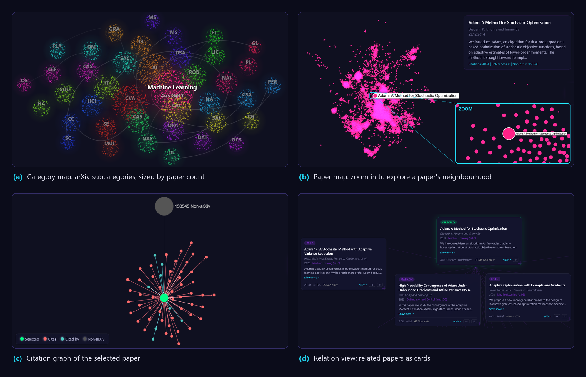

# Monaa-Lisa

**Explore arXiv as an interactive map: similar papers sit close together, and one click shows a paper's citations and related work.**

Developed as part of the 2025 Software Project at Bochum University of Applied Sciences.



## What you can do

- **(a) Browse by field:** arXiv subcategories as clusters, sized by paper count.
- **(b) Zoom into a field:** every dot is a paper; neighbours are papers on similar topics.
- **(c) Follow citations:** see what a paper cites and what cites it.
- **(d) Find related work:** related papers as cards, one click away.
- **Search** by title: matches light up on the map and are listed in the sidebar.

## How it works

```
arXiv (OAI-PMH) ─► Semantic Scholar ─► PCA + UMAP ─► Postgres ─► NestJS API ─► SvelteKit map
   new papers      embeddings,          768-d → 2-d
                   citations
```

A Python pipeline imports papers, places them on the 2-D map and checks arXiv for new papers every month.

## Quickstart

1. Copy the example environment file and set your own database user, password and name (nothing runs without it):

    ```sh
    cp .env.example .env
    ```

2. Start everything with Docker Compose:

    ```sh
    docker-compose up --build
    ```

3. Open the app at http://localhost:5173

On the first start the app downloads the dataset and models and imports them into the database. This takes a while.

<details>
<summary><b>Configuration</b></summary>

| Variable | Purpose |
| --- | --- |
| `POSTGRES_USER`, `POSTGRES_PASSWORD`, `POSTGRES_DB` | Database credentials (required) |
| `FRONTEND_ORIGIN` | Allowed origin for the API (default `http://localhost:5173`) |
| `PUBLIC_API_BASE_URL` | API URL used by the frontend (default `http://localhost:3000`) |
| `SEMANTIC_SCHOLAR_API_KEY` | Optional, raises the Semantic Scholar rate limit |
| `ADMIN_TOKEN` | Enables `POST`/`PATCH`/`DELETE /papers`; empty = disabled |

Ports: frontend `5173`, API `3000`, Postgres `5432` (localhost only).

</details>

<details>
<summary><b>Filling gaps in the database</b></summary>

`backfill_arxiv.py` compares the database against all of arXiv and queues missing papers. It is resumable; a full run takes a few hours.

```sh
docker compose run --rm app python MonaaLisa/src/backfill_arxiv.py --dry-run   # only count what is missing
docker compose run --rm app python MonaaLisa/src/backfill_arxiv.py             # queue missing papers
```

</details>

## License

Copyright (C) 2026 Nico Bestek, Bastian Rosinski, Lenio Cabral-Rosario, Nick Wittkowski

Unless otherwise stated, all files in this repository are licensed under the **GNU Affero General Public License v3 (AGPL-3.0)**.

See the [LICENSE](LICENSE) file for the full license text.
